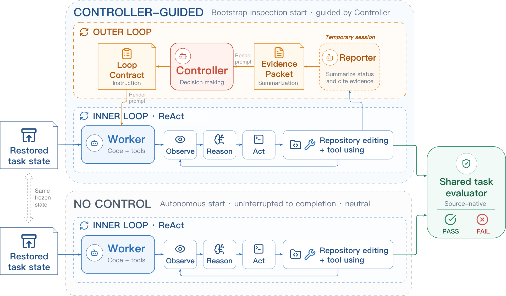

<p align="center">
  
  
</p>

<p align="center"><strong>DreamX Team</strong></p>

<p align="center">
  <a href="https://arxiv.org/abs/2608.28281">Paper</a> ·
  <a href="https://amap-ml.github.io/LoopArena/">Project website</a> ·
  <a href="https://amap-ml.github.io/LoopArena/#results">Results</a> ·
  <a href="docs/setup.md">Get started</a>
</p>

<p align="center">
  <a href="pyproject.toml"></a>
  <a href="LICENSE"></a>
</p>

**LoopArena** evaluates models as runtime Controllers of a separate coding
Worker. The Controller reviews progress, assigns the next step, requests
verification, and decides when to stop. Type II/III compare Controller models
with a shared Worker, Reporter, task, budget, and source-native evaluator.

## News

- **October 14, 2026:** We expanded LoopArena from 90 to **160 Type I questions**
  and from 27 to **80 paired Type II/III coding tasks**. The coding tasks span
  SCBench, BeyondSWE, and LoopsBench. See the updated
  [leaderboard](https://amap-ml.github.io/LoopArena/#results) and
  [setup guide](docs/setup.md).
- **August 28, 2026:** The [LoopArena paper](https://arxiv.org/abs/2608.28281) and
  open-source benchmark were released.

## Benchmark

| Setting | Controller task | Scope | Size | Metric |
| --- | --- | --- | ---: | --- |
| **Type I** | Choose the best of four complete Loop Contracts | One frozen control point | 160 questions | Contract Accuracy |
| **Type II** | Guide a Worker through a condensed coding task | One task slice | 80 tasks × 3 repeats | Strict Success Rate |
| **Type III** | Guide a Worker through a full coding task | Original task state | 80 tasks × 3 repeats | Strict Success Rate |

Type II and III are paired across **21 SCBench**, **29 BeyondSWE**, and
**30 LoopsBench** tasks. Type I evaluates one multiple-choice decision without
running a Worker. The coding settings retain Controller–Worker interaction and
use source-native terminal evaluation. For SCBench, the primary success
criterion is Core checks; protocol and budget validity are required for every
source.

<p></p>

The Worker changes the repository. A read-only Reporter summarizes observable
progress, and the Controller receives an Evidence Packet and returns the next
Loop Contract. No-control and fixed-control policies are reported as references;
they are not included in the Controller-model ranking. See the
[protocol](docs/protocol.md) for role boundaries, budgets, and scoring.

## Results

The main panels evaluate six Controller models. All Type II/III Controller
panels use Qwen3.7-Plus as the shared Worker and Reporter. The table shows the
primary Core-based score; each coding-task panel has 240 runs.

| Controller | Type I accuracy | Type II SSR | Type III SSR |
| --- | ---: | ---: | ---: |
| Qwen3.6-35B-A3B | 43.13% | 55.83% | 33.75% |
| Qwen3.7-Plus | 60.63% | 56.67% | 34.17% |
| DeepSeek-V4-Flash-0731 | 45.63% | 50.83% | 28.33% |
| GLM 5.2 | 54.38% | 40.42% | 24.17% |
| GPT-5.5 | 61.88% | 56.67% | 36.25% |
| Claude Opus 4.8 | 56.25% | 58.75% | 33.75% |

The [interactive leaderboard](https://amap-ml.github.io/LoopArena/#results)
also shows reference policies and estimated costs. Its
[aggregate data](docs/data/results.json) covers all three settings. Costs are
normalized no-cache inference estimates, not invoices.

## Quick start

Install Python 3.10+ and the model-gateway dependency:

```sh
python -m pip install -e '.[gateway]'
```

Configure an OpenAI-compatible endpoint using [`.env.example`](.env.example)
or environment variables. Model IDs are supplied explicitly:

```sh
export OPENAI_API_KEY=YOUR_API_KEY
export OPENAI_BASE_URL=YOUR_BASE_URL

looparena-type1-run --data benchmarks/type1/questions \
  --model MODEL_ID --preflight-only

looparena-type1-run --data benchmarks/type1/questions \
  --model MODEL_ID --output runs/type1-smoke.jsonl --limit 1
```

Type II/III require the pinned upstream task data, starting workspaces, and
Docker runtimes. Follow [data preparation and execution](docs/setup.md) for
source revisions, local paths, preparation commands, and single-case or panel
runs. Large upstream repositories and container images are obtained from their
original sources.

## Repository guide

- [`benchmarks/type1/`](benchmarks/type1/): 160 questions and scoring format.
- [`benchmarks/type2/`](benchmarks/type2/): 80 condensed coding tasks.
- [`benchmarks/type3/`](benchmarks/type3/): 80 paired full coding tasks.
- [`src/looparena/`](src/looparena/): preparation, execution, and evaluation code.
- [`docs/setup.md`](docs/setup.md): installation and resource preparation.
- [`docs/protocol.md`](docs/protocol.md): experimental protocol.

## Citation

If you use LoopArena, please cite the [paper](https://arxiv.org/abs/2608.28281):

```bibtex
@article{wang2026looparenabenchmarkingmodelsruntime,
  title={LoopArena: Benchmarking Models as Runtime Controllers for Loop Engineering},
  author={Yi Wang and Haopeng Zhang and Chengxiang Huang and Rui Dai and Kaikui Liu and Piotr Koniusz and Xiangxiang Chu},
  journal={arXiv preprint arXiv:2608.28281},
  year={2026},
  url={https://arxiv.org/abs/2608.28281}
}
```

LoopArena code and documentation are licensed under [Apache-2.0](LICENSE).
Third-party task material retains its own terms; see
[third-party notices](THIRD_PARTY_NOTICES.md).
